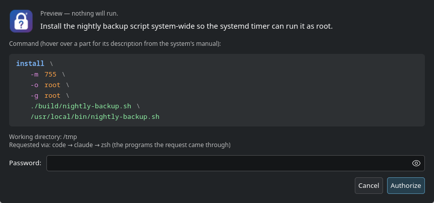

<p align="center"></p>

# rootwhy

**sudo with a password dialog that says _why_ — and shows what every part of the command does.**

[Polski](README.pl.md)

When an AI coding agent (or a script) needs root, it usually ends up in front of you as a bare password prompt or
a one-line command you have to decode. `rootwhy` shows a dialog with:

- the **reason**, written by whoever asks (e.g. the agent),
- the **command split into lines and coloured** — command, options, values, paths,
- **on hover, what each part does — from your system's own manual** (`man`, in your language when translated),
  plus a ⚠ warning when something deserves attention: the destination file will be replaced, the program or script
  could be changed by someone other than root, a path does not exist, a setuid mode, an unknown user,
- the working directory and the programs the request came through (e.g. `code → claude → zsh`).

Nothing is invented: rootwhy has no description table of its own and does not take explanations from the
requester. A part the system knows nothing about simply has no tooltip.

The password goes from the dialog straight to `sudo`. The caller never sees it.



Hovering over `-m`, for example, shows *set permission mode (as in chmod), instead of rwxr-xr-x* — the text from
`man install`. Hovering over the destination shows *⚠ an existing file — it will be replaced* when it is.

## Usage

```bash
rootwhy -r "Restart Ollama after changing its service file." systemctl restart ollama

rootwhy -r "Install the nightly backup script system-wide so the timer can run it as root." \
        -- install -m 755 -o root -g root ./build/nightly-backup.sh /usr/local/bin/nightly-backup.sh
```

| Option | |
| --- | --- |
| `-r, --reason TEXT` | why the command is needed, 10–300 characters (required) |
| `--log-dir DIR` | log directory (default `$XDG_STATE_HOME/rootwhy`, i.e. `~/.local/state/rootwhy`; also `ROOTWHY_LOG_DIR`) |
| `--preview` | show the dialog only, run nothing |

Exit code: the command's own, `130` when cancelled, `2` for usage errors. A wrong password lets `sudo` ask again
(up to 3 times), and the dialog says so.

### For AI agents — Claude Code plugin

The repository is also a Claude Code plugin: a **skill** that tells the agent when and how to use rootwhy, and a
**hook** that stops `sudo`, `pkexec`, `doas`, `run0` and `su` called directly and points to rootwhy instead.

```text
/plugin marketplace add DragonKing026/rootwhy
/plugin install rootwhy@rootwhy
```

The plugin does not install the program — do that first (see Installation). For other agents put the same rule in
`AGENTS.md`:

```markdown
Commands that need root: only through `rootwhy -r "What and why, 1–2 sentences." -- command …`, never `sudo`
directly. Tell the user a password dialog is about to appear. Exit code 130 means they cancelled — do not retry
without asking.
```

## Security model

- **Every call asks for the password** (`sudo -k`): no reuse of an earlier approval.
- **Askpass mode only under the real sudo.** `rootwhy` is its own `SUDO_ASKPASS`. In that mode it shows the dialog
  only when its parent is `sudo` started by you: process name `sudo`, real UID yours, effective UID 0 (only a
  setuid-root program has that) and, when visible, a root-owned setuid executable. An inherited environment or a fake
  `sudo` cannot turn it into a prompt that hands your password to whoever started it.
- **What you see is what runs.** The command in the dialog is read from the parent sudo's own `/proc/PID/cmdline`,
  not from anything the requester passes in: calling `sudo` directly with rootwhy as askpass and a harmless-looking
  description still shows the real command. The command name is resolved to an absolute path before sudo gets it.
  Nothing is shortened; arguments are shell-quoted, and invisible or bidirectional-control characters are shown as
  escapes such as `$'\u202e'`.
- **Clean dialog process.** Python runs with `-I`, and the dialog keeps only display, session and language variables:
  `PYTHONPATH`, `GIO_EXTRA_MODULES`, `GTK_*`, `QT_PLUGIN_PATH` and the like cannot load foreign code into the
  process that holds your password.
- **Nothing runs before you agree.** Descriptions come only from `man` / its parsed page (which never executes the
  command — `--help` is never called) and warnings from `stat` of the paths involved.
- **The requester cannot put words in the tooltips.** Only the reason comes from the requester. A dishonest
  requester can lie in the reason — the command itself is what you approve.
- **The program is shown by name** (`ls`) only when `sudo` would find that very file by that name and it is safe;
  otherwise the full path and a warning.
- **Log without passwords:** date, reason, command and exit code, one line each, written before the dialog opens.

Limits: `rootwhy` cannot tell what a script will do when it runs — only what file it is and who can change it (it
warns when the program or script is not owned by root or is writable by others). Passwordless `sudo` rules
(`NOPASSWD`) or PAM methods such as a fingerprint reader skip the askpass dialog entirely.

## Installation

One file, nothing else to install. Download it from the
[latest release](https://github.com/DragonKing026/rootwhy/releases/latest), check the checksum, make it executable:

```bash
mkdir -p ~/.local/bin && cd ~/.local/bin
curl -fsSLO https://github.com/DragonKing026/rootwhy/releases/latest/download/rootwhy
curl -fsSL https://github.com/DragonKing026/rootwhy/releases/latest/download/SHA256SUMS | sha256sum -c
chmod +x rootwhy
rootwhy --version
```

It uses what a Linux desktop already has: `sudo`, Python 3 and the GTK bindings for Python (PyGObject) — GTK 4, or
GTK 3 when GTK 4 is missing. Where neither is available it falls back to `kdialog` (KDE) or `zenity` (GNOME): the
reason and the command split into lines, without colours and hover. Works on KDE Plasma and GNOME, Wayland and X11.

Update: download the new release the same way. Uninstall: `rm ~/.local/bin/rootwhy` (and `~/.local/state/rootwhy`
for the log).

## Language

The few fixed texts of the dialog (buttons, warnings) follow `LANG` / `LC_MESSAGES`: Polish for `pl_*`, English
otherwise; force with `ROOTWHY_LANG=en` or `ROOTWHY_LANG=pl`. Descriptions are in whatever language your man pages
are — install your distribution's translated man pages (e.g. `man-pages-pl`) to get them in your language.

## Development

```bash
python3 -m unittest discover tests        # command model, man parsing, warnings, translations (no GTK, no sudo)
./rootwhy --preview -r "Testing the dialog." -- install -m 644 a /etc/b
./rootwhy --screenshot out.png -r "Testing the dialog." -- systemctl restart foo   # renders the window to PNG
ROOTWHY_GTK=3 ./rootwhy --preview -r "Testing GTK 3." -- true                      # force the GTK 3 dialog
```

The logo is embedded in the program (`LOGO_SVG`, kept equal to `logo.svg` by a test), so the release is one file.

The program is a single file on purpose — it receives your password, so it should be easy to read in one sitting.
Tests and `ruff` run on every push (`.github/workflows/test.yml`).

## Related projects

- [Salkcid/approve](https://github.com/Salkcid/approve) + [askpass](https://github.com/Salkcid/askpass) — Rust/GTK 4
  review dialog with a reason and process snapshot (Wayland only).
- [crypdick/sudoplz](https://github.com/crypdick/sudoplz) — approve agents' sudo with an SSH-key-encrypted password.

## License

[GPL-3.0-or-later](LICENSE). You may use, change and sell it, but anything you distribute that is based on it must
stay under the same license, with source code.
