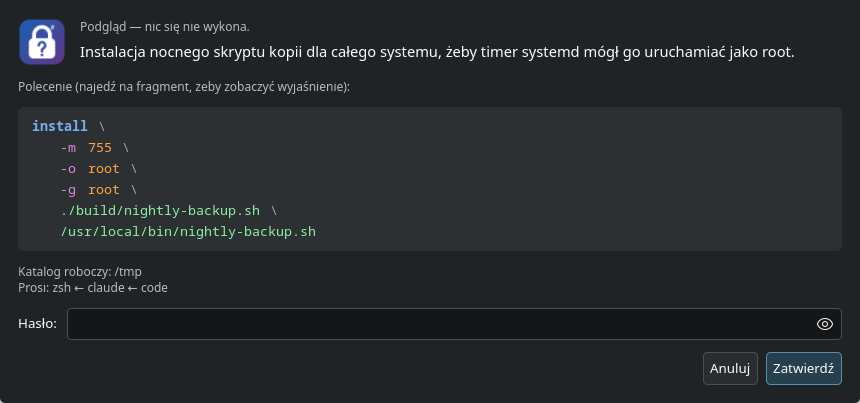

<p align="center"></p>

# rootwhy

[](https://github.com/DragonKing026/rootwhy/actions/workflows/test.yml)
[](https://github.com/DragonKing026/rootwhy/actions/workflows/codeql.yml)
[](https://github.com/DragonKing026/rootwhy/actions/workflows/security.yml)
[](https://github.com/DragonKing026/rootwhy/actions/workflows/release.yml)
[](https://scorecard.dev/viewer/?uri=github.com/DragonKing026/rootwhy)

**sudo z okienkiem na hasło, które mówi _po co_ — i pokazuje, co robi każdy fragment polecenia.**

[English](README.md)

Gdy agent AI (albo skrypt) potrzebuje roota, zwykle dostajesz gołe pytanie o hasło albo jednowierszowe polecenie do
rozszyfrowania. `rootwhy` pokazuje okienko z:

- **powodem**, napisanym przez proszącego (np. agenta),
- **poleceniem podzielonym na wiersze i pokolorowanym** — polecenie, opcje, wartości, ścieżki,
- **po najechaniu: co robi każdy fragment — z podręcznika Twojego systemu** (`man`, po polsku, jeśli jest
  tłumaczenie), a do tego ostrzeżenie ⚠, gdy coś wymaga uwagi: plik docelowy zostanie zastąpiony, program lub skrypt
  może zmienić ktoś poza rootem, ścieżka nie istnieje, tryb setuid, nieznany użytkownik,
- katalogiem roboczym i programami, przez które przyszła prośba (np. `code → claude → zsh`).

Nic nie jest wymyślone: rootwhy nie ma własnej tabeli opisów i nie bierze wyjaśnień od proszącego. Fragment, o którym
system nic nie wie, po prostu nie ma dymka.

Hasło idzie z okienka prosto do `sudo`. Proszący go nie widzi.



Najechanie na `-m` pokazuje np. *set permission mode (as in chmod), instead of rwxr-xr-x* — tekst z `man install`.
Najechanie na cel pokazuje *⚠ plik istnieje — zostanie zastąpiony*, jeśli tak jest.

## Użycie

```bash
rootwhy -r "Restart Ollamy po zmianie pliku usługi." systemctl restart ollama

rootwhy -r "Instalacja nocnego skryptu kopii dla całego systemu, żeby timer mógł go uruchamiać jako root." \
        -- install -m 755 -o root -g root ./build/nightly-backup.sh /usr/local/bin/nightly-backup.sh
```

| Opcja | |
| --- | --- |
| `-r, --reason TEKST` | po co jest polecenie, 10–300 znaków (wymagane) |
| `--log-dir KATALOG` | katalog dziennika (domyślnie `$XDG_STATE_HOME/rootwhy`, czyli `~/.local/state/rootwhy`; także `ROOTWHY_LOG_DIR`) |
| `--preview` | tylko pokaż okienko, niczego nie uruchamiaj |

Kod wyjścia: kod polecenia, `130` po anulowaniu, `2` przy złym użyciu. Po błędnym haśle `sudo` pyta ponownie
(do 3 razy), a okienko o tym mówi.

### Dla agentów AI — wtyczka Claude Code

Repozytorium jest też wtyczką Claude Code: **skill**, który mówi agentowi, kiedy i jak używać rootwhy, oraz **hook**,
który zatrzymuje `sudo`, `pkexec`, `doas`, `run0` i `su` wywołane wprost i odsyła do rootwhy. Hookiem jest sam
program: uruchamia `rootwhy hook`.

```text
/plugin marketplace add DragonKing026/rootwhy
/plugin install rootwhy@rootwhy
```

Wtyczka nie instaluje programu — [`install.sh`](#instalacja) instaluje jedno i drugie. **Bez rootwhy 3.x w `PATH` albo
w `~/.local/bin` hook ostrzega** (jedna linia, nic nie blokuje) — goły `sudo` nie jest wtedy zatrzymywany. Dla innych agentów ta sama reguła w `AGENTS.md`:

```markdown
Polecenia wymagające roota — tylko przez `rootwhy -r "Co i po co, 1–2 zdania." -- polecenie …`, nigdy `sudo`
wprost. Uprzedź użytkownika, że pojawi się okienko z hasłem. Kod 130 = anulował — nie ponawiaj bez pytania.
```

## Bezpieczeństwo

- **Każde wywołanie pyta o hasło** (`sudo -k`) — bez korzystania z wcześniejszej zgody.
- **Tryb hasła tylko pod prawdziwym sudo.** `rootwhy` jest swoim własnym `SUDO_ASKPASS`. W tym trybie pokaże okienko
  tylko wtedy, gdy rodzicem jest `sudo` uruchomione przez Ciebie: nazwa procesu `sudo`, rzeczywisty UID Twój,
  efektywny UID 0 (ma go tylko program setuid roota) i, gdy jest widoczny, plik wykonywalny roota z bitem setuid.
  Odziedziczone środowisko ani podrobione `sudo` nie zamienią go w okienko, które odda hasło temu, kto je uruchomił.
- **Widzisz to, co się wykona.** Polecenie w okienku pochodzi z `/proc/PID/cmdline` samego sudo, nie z danych od
  proszącego: wywołanie `sudo` wprost z rootwhy jako programem pytającym i niewinnym opisem i tak pokaże prawdziwe
  polecenie. Nazwa polecenia jest zamieniana na ścieżkę bezwzględną, zanim dostanie ją sudo. Nic nie jest skracane;
  argumenty są w cudzysłowach jak w powłoce, a znaki niewidoczne i sterujące kierunkiem tekstu są pokazane jako
  np. `$'\u202e'`.
- **Czysty proces okienka.** Okienko to osobny program (`rootwhy-gtk`, szukany tylko obok samego `rootwhy`)
  z wyczyszczonym środowiskiem, które zachowuje tylko zmienne ekranu, sesji i języka: `GIO_EXTRA_MODULES`, `GTK_*`,
  `QT_PLUGIN_PATH`, `LD_*` itp. nie wczytają obcego kodu do procesu z hasłem.
- **Nic nie działa przed zgodą.** Opisy pochodzą tylko z `man` (nie uruchamia polecenia — `--help` nigdy nie jest
  wywoływane), a ostrzeżenia ze `stat` ścieżek.
- **Proszący nie wpisze nic do dymków.** Od proszącego pochodzi tylko powód. Nieuczciwy proszący może skłamać
  w powodzie — zatwierdzasz samo polecenie.
- **Program pokazany z nazwy** (`ls`) tylko wtedy, gdy `sudo` znajdzie po tej nazwie ten sam plik i jest on bezpieczny;
  inaczej pełna ścieżka i ostrzeżenie.
- **Dziennik bez haseł:** data, powód, polecenie i kod wyjścia, po jednym wierszu, zapisany przed otwarciem okienka.

Ograniczenia: `rootwhy` nie wie, co zrobi skrypt po uruchomieniu — tylko jaki to plik i kto może go zmienić (ostrzega,
gdy program lub skrypt nie należy do roota albo inni mogą go zmieniać). Reguły `sudo` bez hasła (`NOPASSWD`) i metody
PAM, np. czytnik linii papilarnych, całkowicie pomijają okienko.

## Instalacja

Dwa sposoby — ten sam wynik:

- **A. Skrypt** — jedno polecenie robi wszystkie trzy kroki z listy niżej.
- **B. Ręcznie** — pełna lista, krok po kroku.

W obu przypadkach potrzebne są: Linux (x86_64 lub aarch64, glibc ≥ 2.35) z pulpitem (KDE Plasma albo GNOME, Wayland
albo X11), `sudo`, `curl`. Do pełnego okienka także GTK 4 ≥ 4.6 z dystrybucji (opcjonalnie — bez niego okienko to
`zenity` albo `kdialog`). Python nie jest potrzebny.

### A. Skrypt

Pobierz, przeczytaj, uruchom:

```bash
curl -fsSLO https://raw.githubusercontent.com/DragonKing026/rootwhy/main/install.sh
less install.sh
bash install.sh
```

| Krok | Co robi | Pominięcie |
| --- | --- | --- |
| 1. Programy | pobiera `rootwhy` i `rootwhy-gtk` dla Twojego procesora z wydania `v3.0.0`, sprawdza oba w `SHA256SUMS`, kładzie obok siebie w `~/.local/bin` | — (`--dir KATALOG`, `--version vX.Y.Z`) |
| 2. GTK | sprawdza, czy `rootwhy-gtk` znajduje GTK 4; jeśli nie, wypisuje pakiet do doinstalowania dla `dnf`, `apt`, `pacman` albo `zypper` (nic nie instaluje jako root) i mówi, że do tego czasu okienko to `zenity` / `kdialog` | `--no-gtk` (pomija też `rootwhy-gtk`) |
| 3. Wtyczka | gdy jest `claude`: dodaje marketplace i instaluje `rootwhy@rootwhy` dla użytkownika (skill + hook) | `--no-plugin` |

`bash install.sh --help` pokazuje opcje. Ponowne uruchomienie wszystko aktualizuje. Zastępuje `rootwhy` 2.x w katalogu
docelowym.

### B. Ręcznie

**1. Programy** — dwa pliki z wydania, sprawdzone sumami. Muszą trafić **do tego samego katalogu**: `rootwhy` szuka
`rootwhy-gtk` tylko obok siebie.

```bash
ARCH=$(uname -m)    # x86_64 albo aarch64
BASE=https://github.com/DragonKing026/rootwhy/releases/download/v3.0.0
cd "$(mktemp -d)"
curl -fsSLO "$BASE/rootwhy-linux-$ARCH" -O "$BASE/rootwhy-gtk-linux-$ARCH" -O "$BASE/SHA256SUMS"
sha256sum -c --ignore-missing SHA256SUMS
mkdir -p ~/.local/bin
install -m 755 "rootwhy-linux-$ARCH" ~/.local/bin/rootwhy
install -m 755 "rootwhy-gtk-linux-$ARCH" ~/.local/bin/rootwhy-gtk
rootwhy --version
```

`~/.local/bin` musi być w `PATH`.

Wydania po v3.0.0 mają podpisane poświadczenie pochodzenia (`rootwhy.sigstore.json`, Sigstore). Weryfikacja pobranego
pliku (potrzebne [GitHub CLI](https://cli.github.com/)):

```bash
gh attestation verify "rootwhy-linux-$ARCH" --repo DragonKing026/rootwhy --bundle rootwhy.sigstore.json
```

**2. GTK 4** — dla pełnego okienka (kolory, opisy po najechaniu): biblioteka systemowa w wersji 4.6 lub nowszej.

```bash
sudo dnf install gtk4                  # Fedora
sudo apt install libgtk-4-1            # Debian / Ubuntu
sudo pacman -S gtk4                    # Arch
sudo zypper install libgtk-4-1         # openSUSE
ldd ~/.local/bin/rootwhy-gtk | grep 'not found' || echo OK
```

Bez GTK 4 okienko to `zenity` (GNOME) albo `kdialog` (KDE): powód i polecenie w wierszach, bez kolorów i dymków.

**3. Wtyczka Claude Code** (opcjonalnie, dla agentów AI) — skill + hook zatrzymujący `sudo` wprost:

```bash
claude plugin marketplace add DragonKing026/rootwhy
claude plugin install rootwhy@rootwhy --scope user
```

albo w Claude Code: `/plugin marketplace add DragonKing026/rootwhy`, potem `/plugin install rootwhy@rootwhy`. Działa
w nowych sesjach.

**4. Sprawdzenie** — pokazuje okienko, niczego nie uruchamia:

```bash
rootwhy --preview -r "Test okienka." -- install -m 644 a /etc/b
```

### Aktualizacja i odinstalowanie

Aktualizacja: ponownie `install.sh` albo krok 1 i `claude plugin marketplace update rootwhy && claude plugin update
rootwhy@rootwhy`. Odinstalowanie: `rm ~/.local/bin/rootwhy ~/.local/bin/rootwhy-gtk`, `claude plugin uninstall
rootwhy@rootwhy` (oraz `~/.local/state/rootwhy` z dziennikiem).

### Budowa ze źródeł

```bash
sudo dnf install gtk4-devel            # Debian / Ubuntu: libgtk-4-dev
cargo build --release                  # target/release/rootwhy i target/release/rootwhy-gtk
```

Oba pliki skopiuj do jednego katalogu. Pomocnik GTK używa wyłącznie API GTK 4.6, więc pliki z wydania (budowane na
Ubuntu 22.04) działają z GTK 4.6 i nowszym.

### Zmiany względem 2.x

rootwhy 3.0 to przepisanie na Rust z tym samym działaniem. Różnice:

- bez Pythona i PyGObject — dwa programy natywne: `rootwhy` (logika, tryb hasła, hook, zapas `zenity` / `kdialog`)
  i `rootwhy-gtk` (okienko);
- GTK 3 nie jest już obsługiwane (`ROOTWHY_GTK=3` nie ma) — GTK 4 ≥ 4.6 albo zapas `zenity` / `kdialog`;
- argumenty wiersza poleceń muszą być poprawnym UTF-8;
- `--help` wypisuje się bez kolorów;
- hook wtyczki uruchamia `rootwhy hook`; bez zainstalowanego rootwhy 3.x ostrzega (nie blokuje).

## Język

Kilka stałych napisów okienka (przyciski, ostrzeżenia) według `LANG` / `LC_MESSAGES`: polski dla `pl_*`, w pozostałych
angielski; wymuszenie `ROOTWHY_LANG=en` albo `ROOTWHY_LANG=pl`. Opisy są w języku zainstalowanych stron man — po
polsku po instalacji tłumaczeń z dystrybucji (np. `man-pages-pl`).

## Rozwój

```bash
cargo test                                # model polecenia, odczyt man, ostrzeżenia, CLI, hook (bez GTK i sudo)
cargo build --release
target/release/rootwhy --preview -r "Test okienka." -- install -m 644 a /etc/b
target/release/rootwhy --screenshot out.png -r "Test okienka." -- systemctl restart foo   # okno do pliku PNG
```

Logo jest wbudowane w `rootwhy-gtk` (`include_str!` z `logo.svg`). Tag `v*` buduje pliki wydania przez
`.github/workflows/release.yml`.

Program, który dostaje Twoje hasło, jest celowo mały: `rootwhy-gtk` tylko rysuje okienko (dane wchodzą jako JSON na
stdin, hasło wychodzi na stdout), a logika jest w `rootwhy`.

## Licencja

[GPL-3.0-or-later](LICENSE). Wolno używać, zmieniać i sprzedawać, ale wszystko, co rozpowszechniasz na jego podstawie,
musi zostać na tej samej licencji, z kodem źródłowym.
